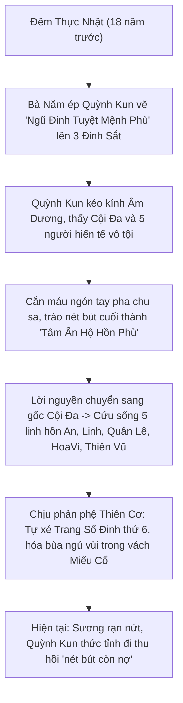

# Hồ Sơ Thiết Kế Nhân Vật: Quỳnh Kun — Thầy Cúng Vẽ Bùa

> [!IMPORTANT]
> Thiết kế dưới đây bám sát 100% cấu trúc cốt truyện, hệ thống RPG 12 chỉ số và quy chuẩn đồ họa 2.5D / Blender-to-Pixel của **Đèn Tinh: Miền Sương Lạc (v0.9.1)**.

---

## 1. Hình Ảnh Nhân Vật (Theo Chuẩn Pipeline Của Codex)

Trong dự án *Đèn Tinh*, một nhân vật do Codex tạo ra luôn đi qua **2 tầng hình ảnh**:
1. **Bảng Concept Art 2.5D** (tương tự [graphics-linh-kiet-20261107.md](file:///e:/Games/DenTinh/design/graphics-linh-kiet-20261107.md)): Thiết kế tỉ lệ 3.5 đầu trên nền xanh ngọc trầm khung vàng, thể hiện chất liệu vải áo dài cách tân, **tóc tết 2 bên**, kính râm tròn đẩy trên trán, đồng xu Phát, chuỗi hạt tràng và 3 ô chiêu thức Q / E / R.
2. **Sprite Pixel Art bake từ Mesh 3D Blender** (sử dụng trực tiếp [pixel_pipeline.py](file:///e:/Games/DenTinh/design/blender/pixel_pipeline.py)): Quy chuẩn `1 texel = 2×2 px`, cao chuẩn `43 texels (86px)` ngang hàng với HoaVi, Thiên Vũ, Quân Lê, An, Linh, viền mực `#12091a` và 4 bậc màu phẳng.

````carousel

<!-- slide -->

<!-- slide -->

````

### Chi tiết nhận diện ngoại hình
- **Áo dài cách tân:** Vạt áo cắt gọn ngang bắp chân để linh hoạt khi lướt né, tông **Chàm Huyền (`#1c324a`)** phối cổ đứng và viền tà **Đỏ Chu Sa (`#d9384a`)**, thêu vân mây đồng cổ ở gấu áo, mặc ngoài quần lụa kem suông và hài cổ thấp.
- **Đồng Xu Phát ở cổ:** Dây tết chỉ đỏ đeo đồng tiền cổ lớn bằng đồng vàng trước ngực (`#e6b347`), lỗ vuông ở giữa phát sáng mỗi khi tích đủ Lộc Khí.
- **Chuỗi hạt tràng ở cổ tay:** Tràng hạt gỗ trầm xen hạt đồng quấn quanh cổ tay; tay phải cầm **Bút Lông Chu Sa**, tay trái xòe xấp **Bùa Hoàng Kim**.
- **Tóc tết 2 bên:** Mái tóc đen rẽ ngôi gọn gàng và **tết thành 2 bím tóc buông xuống hai bên vai**, đuôi tóc buộc dây chỉ đỏ đung đưa theo nhịp di chuyển và vung bút.
- **Kính râm tròn trên trán:** Kính thầy bói gọng đồng tròn màu khói đen **được đẩy lên nằm trên trán** (lộ rõ đôi mắt sắc sảo và nụ cười nửa tỉnh nửa mê). *Điểm nhấn hoạt họa:* Chỉ trong 4,5 giây **Intro Tuyệt Kỹ R**, Quỳnh Kun mới đưa tay kéo kính râm xuống mắt để "Khai Nhãn Âm Dương" nhìn thấu nghiệp chướng, rồi lại đẩy kính lên trán khi dứt chiêu!

---

## 2. Kịch Bản Cuộc Đời & Hợp Lý Hóa Vào Cốt Truyện Game

### Điểm khuyết trong cốt truyện hiện tại làm "chỗ đứng" hoàn hảo cho Quỳnh Kun
Trong [v09-content.js](file:///e:/Games/DenTinh/v09-content.js#L24-L33), lời thoại của **Ông Từ Đạo (`temple_keeper`)** có một chi tiết cực kỳ đắt giá:
> *"Sổ Đinh thiếu **bảy trang**, nhưng tro chỉ còn **năm khoảng tên**. Vết xóa có mùi dầu đèn, không có mùi sương."*

Tại sao Sổ Đinh mất **7 trang** mà tro dưới bàn thờ chỉ có **5 cái tên** (An, Linh, Quân Lê, HoaVi, Thiên Vũ)?
- Trang thứ 7 là trang ghi tên *Người Giữ Đèn Đầu Tiên* (Kẻ Dệt Sương).
- Còn **Trang Thứ Sáu** không hề bị đốt bằng dầu đèn — vì chủ nhân của nó đã **tự tay xé nó ra để gấp thành một lá Bùa Ẩn Danh** ngay trong Đêm Thực Nhật. Người đó chính là **Quỳnh Kun**.



### Tiểu sử: Kẻ Tráo Bùa Trong Đêm Thực Nhật
- **Xuất thân:** Quỳnh Kun là truyền nhân trẻ tuổi cuối cùng của mạch **Phù Thủy Đạo (Nội Đạo)** tại Làng Đèn — người duy nhất trong làng thông tỏ thuật dùng chu sa, đồng tiền cổ và tràng hạt để định mạch đất trời. Ngày thường, Quỳnh Kun tỏ vẻ bất cần, ăn mặc phá cách với tà áo dài cách tân và chiếc kính râm thầy bói lúc nào cũng vắt vẻo trên trán vì bảo: *"Đeo xuống nhìn thấy lòng người đen hơn mực, nhức mắt lắm."*
- **Biến cố Đêm Thực Nhật (18 năm trước):**
  - Khi Bà Năm và dân làng quyết định hiến tế 5 người trẻ tuổi để đổi lấy sự bình yên, họ cần một thầy pháp viết **Văn Tế** và dán **Ngũ Đinh Tuyệt Mệnh Phù** lên ba chiếc Đinh Phong Ấn do Lão Hỏa Sơn rèn. Nếu lá bùa ấy hoàn tất, linh hồn của An, Linh, Quân Lê, HoaVi và Thiên Vũ sẽ bị nghiền nát vĩnh viễn làm nhiên liệu trấn ải.
  - Đứng trước đàn tế mù mịt khói hương, Quỳnh Kun giả vờ vâng lệnh. Nhưng ngay ở nét bút cuối cùng, dưới làn khói, Quỳnh Kun cắn rách đầu ngón tay, hòa máu tim vào nghiên mực chu sa, **sửa chữ "Tuyệt" (絕 - Dứt tuyệt) thành chữ "Hộ" (護 - Bảo hộ)**.
  - Chính lá bùa bị tráo của Quỳnh Kun đã mở đường cho **Cội Đa** nuốt lời nguyền vào thân thay cho 5 người kia, giữ cho linh hồn họ không bị tiêu tan!
- **Cái giá của sự phản nghịch:**
  - Việc tự ý sửa bùa tế thần khiến phản phệ giáng thẳng xuống người cầm bút, đồng thời nếu Bà Năm phát hiện lá bùa trên đinh là *Hộ Hồn Phù*, bà sẽ lập tức hủy đàn tế và giết lại cả 5 người.
  - Để khóa chặt bí mật, Quỳnh Kun lén rút **trang thứ sáu của Sổ Đinh** (trang ghi tên và bát tự của chính mình), gấp thành một lá **Ẩn Danh Phù** nuốt vào ngực, tự biến bản thân thành "cái chốt khóa bùa" ngủ vùi giữa khe nứt thời gian nơi vách Đình Làng.
  - Suốt 18 năm (và hàng nghìn vòng lặp của Kẻ Dệt Sương), cả làng quên sạch sự tồn tại của người thầy cúng trẻ. Ngay cả khi chưa uống Nước Sen Quên Lãng, người ta cũng chỉ nhớ có "năm khoảng trống trong tro", không ai nhớ người cầm bút đứng bên cạnh đàn tế.
- **Thức tỉnh ở hiện tại:**
  - Khi vòng lặp của *Miền Sương Lạc* bắt đầu rạn vỡ, lá Ẩn Danh Phù trong lồng ngực cháy hết. Quỳnh Kun bước ra từ hiên đình làng, phủi bụi chu sa trên tà áo dài cách tân, gõ nhẹ ngón tay lên chiếc kính râm trên trán:
  - *"Vẽ bùa cứu người mà không ký tên thì gọi là làm phúc. Nhưng để lũ quỷ sương mù mượn bùa của ta làm vòng lặp thì là nợ máu. Đi thôi Đốm, thầy đi thu hồi bản quyền."*

### Tuyến Nhiệm Vụ Cá Nhân Của Quỳnh Kun (Tích hợp [v09-content.js](file:///e:/Games/DenTinh/v09-content.js#L54-L60))
- **Mở đầu (`stories.quynhkun.intro`):** *"Vết chu sa trên ba chiếc đinh đang phai. Đã đến lúc người cầm bút năm xưa viết nốt chữ cuối cùng."*
- **Di vật cốt truyện (`stories.quynhkun.relic`):** **Nghiên Chu Sa Nứt & Trang Sổ Đinh Thứ Sáu**.
- **6 Bước Nhiệm Vụ (`quests.quynhkun.steps`):**
  1. **Gặp Ông Từ Đạo (`temple_keeper`) — *"Trang Giấy Không Thành Tro"*:** Ông Từ Đạo kinh ngạc khi thấy Quỳnh Kun đọc vanh vách chữ viết trên trang Sổ Đinh thứ sáu bị xé mất, và chỉ Quỳnh Kun xuống Đầm Sen tìm lại nghiên mực đã ném xuống nước đêm ấy.
  2. **Gặp Thư Sinh Mặc Khách (`scholar_ghost`) — *"Thứ Mực Không Trôi"*:** Hồn ma thư sinh tại Đầm Sen tiết lộ có một nghiên mực đỏ nằm dưới đáy đầm 18 năm mà Nước Quên Lãng không thể làm phai.
  3. **Nhặt Ký Ức `cinnabar-inkstone` tại Đầm Sen `(3180, 2120)` — *"Máu Trên Đầu Bút"*:** Thu hồi Nghiên Chu Sa Nứt, mở đoạn hồi tưởng đêm cắn máu ngón tay sửa bùa cứu 5 linh hồn.
  4. **Thu thập 3 mảnh `nail-talisman-0..2` tại Rừng Trúc, Đầm Sen, Đồi Tro — *"Ba Đạo Phù Trấn Đinh"*:** Gỡ lại 3 mảnh bùa máu năm xưa bám trên 3 Ấn.
  5. **Giải thoát Cội Đa & Trả Ký Ức (`truth`) — *"Giải Chú Trả Tên"*:** Dùng bút chu sa xóa bỏ phong ấn trên rễ Cội Đa, trả lại ký ức cho Làng Đèn.
  6. **Gặp Người Giữ Miếu Chuông (`bell_keeper`) — *"Khắc Lại Tên Người Vẽ"*:** Viết lại tên "Quỳnh Kun" vào Sổ Đinh mới.
- **Phần thưởng hoàn thành (`reward`):** Danh hiệu **Thiên Phù Đại Pháp Sư** (+10% tổng sát thương, +200 xu, +2 điểm kỹ năng).

---

## 3. Thiết Kế Lối Chơi: Bảo Khí, Nội Tại & Bộ Kỹ Năng (Q / E / R)

### Chỉ số cơ bản (`DTWorld.HEROES.quynhkun`)
| Thuộc tính | Giá trị | Định hướng lối chơi |
| :--- | :--- | :--- |
| **Vai trò (`role`)** | `THẦY CÚNG VẼ BÙA` | Pháp sư tầm trung – Kiểm soát trận địa & Kích nổ ấn chú |
| **Máu cơ bản (`hp`)** | `115` | Cao hơn Linh (100) / HoaVi (110), thấp hơn An (120) / Quân Lê (135) |
| **Tốc chạy (`speed`)** | `240` | Cơ động vừa phải nhờ tà áo dài cách tân gọn nhẹ |
| **Sát thương cơ bản (`damage`)** | `17` | Tương tác mạnh với **INT (Trí Lực)**, **SPI (Linh Cảm)**, **DOM (Thống Lĩnh)** và **AURA (Uy Áp)** |
| **Tốc độ đánh (`fireRate`)** | `0.21s` | Phóng bùa nhịp nhàng; đòn thứ 3 là nét bút quét ngang |
| **Tốc độ đạn (`shotSpeed`)** | `760` | Lá bùa bay nhanh, chuẩn xác |
| **Hồi chiêu `Q / E / R`** | `5s / 9s / 19s` | R có Intro 4,5 giây chuẩn cơ chế `0.8.2` |

---

### Bảo Khí Riêng: **Chu Sa Phù Bút & Xấp Bùa Hoàng Kim**
- **Đánh thường (Giữ chuột trái):** Quỳnh Kun búng các **Lá Bùa Hoàng Kim** bay theo hướng ngắm.
- **Nhịp đòn thứ 3 (Tam Bút Thành Chương):** Đòn đánh thường thứ 3 liên tiếp là một cú phẩy **Bút Lông Chu Sa**, phóng ra đạo **Bùa Chu Sa** lớn hơn gây `135% sát thương`, xuyên 1 mục tiêu và văng mực làm chậm nhẹ.

---

### Nội Tại (Passive): **Ngũ Lôi Chu Sa Ấn & Đồng Xu Phát**
> *"Năm nét mực khóa tà ma, một đồng tiền xoay chuyển âm dương."*

1. **Khắc Bùa Chu Sa (Trên mục tiêu):**
   - Mỗi đòn đánh thường hoặc kỹ năng của Quỳnh Kun trúng địch sẽ khắc **1 Nét Chu Sa** lên người chúng (hiển thị bằng các nét chữ triện đỏ xoay quanh quái, tối đa **5 nét**).
   - Khi đủ **5/5 Nét Chu Sa**, lá bùa hoàn chỉnh phát sáng và **Phát Nổ Bùa Chú (Phù Bạo)**:
     - Gây **220% sát thương kỹ năng** trong bán kính `110 px` quanh mục tiêu.
     - Gây **Choáng / Khóa Phép 0.5 giây** lên quái thường (Boss bị khựng và giảm 15% tốc độ ra đòn trong 1.5 giây).
2. **Đồng Xu Phát & Chuỗi Hạt Tràng (Trên bản thân):**
   - Mỗi lần khắc nét thứ 3 hoặc kích nổ một lá bùa, **Đồng Xu Phát** trước ngực ngân lên, hồi **5 Linh Lực (MP)**, cấp **8 Khiên Hộ Mệnh** (tối đa cộng dồn khiên nội tại tới 65) và tích **1 tầng Lộc Khí** (tối đa **6 tầng**).
   - Khi đủ **6/6 Lộc Khí**, Đồng Xu Phát rực sáng ánh kim: Kỹ năng **Q** hoặc **E** tiếp theo sẽ tiêu thụ 6 tầng Lộc Khí để bước vào trạng thái **"Thỉnh Thần"** — cường hóa mạnh chiêu thức và giảm ngay `1.5 giây` hồi chiêu của kỹ năng còn lại!
- **Nâng cấp Nhánh Nội Tại (Phím K – 3 bậc, tên nhánh: `Chu Sa Tuyệt Bút`):**
  - *Mỗi bậc:* Sát thương nổ bùa +18%; khi bùa nổ trên một kẻ địch, mực chu sa bắn sang **1 kẻ địch gần nhất** khắc sẵn **2 Nét Chu Sa**; lượng khiên từ Đồng Xu Phát +4 mỗi bậc.

---

### Chiêu Q: **Họa Phù · Thiên Cương Trảm**
- **Năng lượng:** `24 MP` | **Hồi chiêu:** `5.0 giây` | **Nhánh K:** `Họa Phù`
- **Mô tả:**
  - Quỳnh Kun xoay bút lông vẽ một nét chu sa rực lửa trên không trung rồi phóng **Đại Phù Thiên Cương** bay dọc hướng ngắm (`680 px`, rộng `26 px`), xuyên qua mọi kẻ địch trên đường bay, gây **340% sát thương** và khắc ngay **+2 Nét Chu Sa** lên tất cả mục tiêu trúng đòn.
  - **Cường hóa Đồng Xu Phát (Đủ 6 Lộc Khí):** Phóng ra **3 đạo bùa hình rẻ quạt (Tam Tài Phù)**; tại điểm cuối đường bay, lập tức **kích nổ sớm** mọi kẻ địch đang có từ **3 Nét Chu Sa** trở lên (với 85% sát thương Phù Bạo) mà không cần đợi đủ 5 nét!
- **Chuyên Môn Hóa Bậc 3 (`specs.q`):**
  - **Tập Trung (`focus` – *Nhất Điểm Chu Sa*):** Sát thương chính +25%, bùa bay nhanh hơn 30%, khắc thẳng **+3 Nét Chu Sa** lên mục tiêu đầu tiên trúng đòn.
  - **Bộc Phát (`burst` – *Phù Hỏa Thiêu Tà*):** Sát thương đường bay −15%, nhưng để lại một vệt giấy bùa cháy đỏ trên mặt đất suốt `2.5 giây`, gây sát thương đốt và nổ vùng tại điểm cuối.

---

### Chiêu E: **Trấn Trạch Bát Quái Trận (Tái kích hoạt: Thu Phù Hộ Thể)**
- **Năng lượng:** `30 MP` | **Hồi chiêu:** `9.0 giây` | **Nhánh K:** `Trấn Trạch`
- **Lần 1 — Cắm Cọc Bùa (Đặt Kết Giới):**
  - Quỳnh Kun tung chuỗi hạt tràng và cắm một **Cọc Bùa Bát Quái** tại điểm ngắm (bán kính `145 px`, tồn tại `7 giây`, tối đa 2 trận cùng lúc; tính là vật triệu hồi/trận địa nhận加成 từ chỉ số **DOM Thống Lĩnh** và **AURA Uy Áp**).
  - Các lá bùa vàng nối với nhau bằng **Dây Chỉ Đỏ** xoay quanh cọc:
    - Kẻ địch bước qua rìa dây chỉ đỏ bị **Trói Chân 1.2 giây** (Boss bị làm chậm 35%).
    - Mỗi `0.75 giây`, trận pháp giáng một tia sét chu sa vào kẻ địch bên trong, gây sát thương và khắc **+1 Nét Chu Sa**.
    - Đạn của kẻ địch bay xuyên qua vòng bùa bị giảm 35% tốc độ bay.
- **Lần 2 — Tái kích hoạt trong 4 giây (`Nhấn E lần nữa: THU PHÙ`):**
  - Tương tự cơ chế tái kích E của An và HoaVi, khi nhấn **E lần thứ hai**, Quỳnh Kun gõ vào Đồng Xu Phát, **giật toàn bộ các lá bùa từ Cọc Bát Quái bay ngược về xoay quanh bản thân**:
    - Cọc bùa phát nổ, **kéo nhẹ các quái thường xung quanh gom vào tâm trận** trước khi biến mất.
    - Quỳnh Kun nhận **Vòng Bùa Hộ Thể** trong `4 giây`: nhận **25 Khiên**, tăng **20% tốc chạy**, và mỗi `0.5 giây` tự động bắn 1 lá bùa truy kích kẻ địch gần nhất!
- **Chuyên Môn Hóa Bậc 3 (`specs.e`):**
  - **Bền Vững (`lasting`):** Kết giới Bát Quái tồn tại lâu hơn 40%, cấp thêm 15 khiên ngay khi đặt và hồi `3 HP/giây` khi Quỳnh Kun đứng trong trận.
  - **Ứng Biến (`agile`):** Hồi chiêu E giảm 25%; đặt cọc hoặc thu bùa giúp tăng 15% tốc chạy trong 2 giây.

---

### Chiêu R (Tuyệt Kỹ): **Cấp Cấp Như Luật Lệnh · Bách Phù Trấn Thiên**
- **Năng lượng:** `0 MP` | **Hồi chiêu:** `19.0 giây` | **Nhánh K:** `Thiên Mệnh`
- **Hoạt cảnh Intro 4,5 giây (Chuẩn hệ thống Ultimate Intro v0.8.2):**
  - Khi nhấn **R**, màn hình chuyển sắc chàm – vàng hoàng kim. Quỳnh Kun **miễn sát thương và khống chế**, di chuyển ở 35% tốc độ; địch trong `520 px` chỉ còn 25% tốc độ và bị sóng âm từ Đồng Xu Phát đẩy lùi nhẹ mỗi `0.8 giây`.
  - **Điểm nhấn biểu cảm:** Quỳnh Kun đưa tay lên trán, **kéo nhẹ chiếc kính râm tròn xuống mắt** (*Khai Nhãn Âm Dương*). Dưới chân hiện lên đồ hình **Bát Quái Thái Cực** khổng lồ bằng nét mực chu sa và hàng chục lá bùa vàng bay lơ lửng quanh thân.
- **Khi kết thúc Intro (Nhả Tuyệt Kỹ):**
  - Quỳnh Kun đẩy kính râm trở lại lên trán, phẩy bút hô vang: **"Cấp Cấp Như Luật Lệnh!"**
  - Triển khai **Đại Trận Bách Phù** (bán kính `260 px` tại hướng ngắm, tồn tại `8 giây`):
    1. **8 Cột Trâm Gỗ & Dây Bùa** cắm xuống đất khóa chặt chiến trường.
    2. **32 Đạo Bùa Thiên Lôi** từ trên trời lần lượt giáng xuống trong suốt `8 giây`, ưu tiên đánh vào các mục tiêu đang có dấu Chu Sa.
    3. **Thiên Phù Cộng Hưởng:** Trong thời gian Đại Trận tồn tại, mọi kẻ địch trong trận nhận thêm **20% sát thương từ mọi nguồn**, và mỗi lần **Nổ Bùa (5 nét Chu Sa)** sẽ giáng thêm một tia **Sét Chu Sa gây sát thương chuẩn (True Damage)**!
- **Chuyên Môn Hóa Bậc 3 (`specs.r`):**
  - **Uy Lực (`might`):** Sát thương tuyệt kỹ +25% và tăng thêm 10 đạo bùa giáng xuống.
  - **Tái Sinh (`renewal`):** Sát thương −15%; khi nhả chiêu lập tức hồi **18% Máu tối đa + 20 Linh Lực** cho Quỳnh Kun.

---

## 4. Tương Tác Với Hệ Thống Cổ Vật & 12 Chỉ Số RPG

| Nhóm Build (Chỉ số `I`) | Cách kết hợp với Quỳnh Kun | Cổ vật khuyên dùng (`v0.9.1`) |
| :--- | :--- | :--- |
| **Thuần Phù Chú (INT + SPI + AURA)** | Tăng sát thương nổ bùa Chu Sa, giảm hồi chiêu Q/E/R (tối đa 45% CDR) và mở rộng phạm vi Kết Giới Bát Quái. | **Đèn Thần Aladdin** (tiêu MP bắn tia sáng), **Lõi Băng Thiên Cơ** (giảm 22% hồi chiêu), **Ngọc Tịnh Tâm**. |
| **Tốc Họa Liên Hoàn (AGI + DEX + FER)** | Búng bùa cực nhanh để kích hoạt đòn thứ 3 liên tục, tích 5 nét Chu Sa lên Boss chỉ trong 1.5 giây. | **Nỏ Liên Châu Cổ (Split)** (bắn thêm lá bùa phụ), **Mũi Giáo Xuyên Vân (Pierce)**, **Ấn Búa Mjölnir**. |
| **Trận Pháp Sư (DOM + VIT + DEF)** | Tăng thời gian tồn tại, nhịp giáng sét của Cọc Bát Quái (E) và lượng khiên dày từ Đồng Xu Phát + Thu Phù. | **Chìa Khóa Ankh** (hạ địch bị trói bởi dây bùa hồi 5% Máu + tăng 15% sát thương), **Đàn Thần Thạch Sanh** (E mê hoặc quái). |
